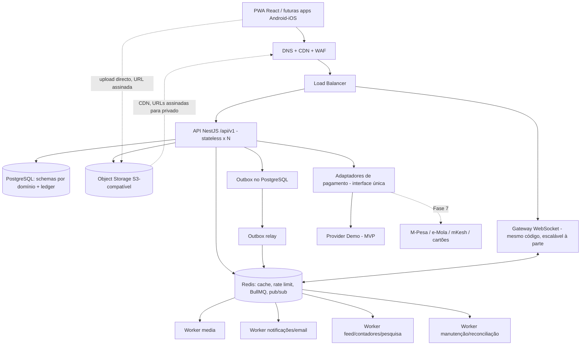

# Txillapp — Arquitectura Técnica (v0.1, para validação)

Estado: **proposta**. Nenhum código de aplicação foi escrito. A implementação só começa após validação deste documento (ver §10, decisões em aberto).

## 1. Diagrama de arquitectura



Princípios práticos: monólito modular + processos `api`, `worker`, `relay` a partir da mesma base de código (imagens/entrypoints distintos). Redis nunca é fonte de verdade de saldos nem de mensagens.

## 2. Estrutura do repositório (monorepo pnpm workspaces)

```
txillapp/
  apps/
    web/            # React + Vite + TS strict + Tailwind + PWA
    api/            # NestJS (entrypoints: main.ts, worker.ts, relay.ts)
    admin/          # painel admin (React, mesma lib de UI, rotas protegidas + MFA)
  packages/
    ui/             # design system acessível
    api-client/     # cliente gerado do OpenAPI (reutilizável por RN/Flutter)
    shared/         # schemas Zod, tipos, constantes
    config/         # eslint, tsconfig, prettier
  infra/
    docker/         # Dockerfiles, compose de desenvolvimento
    terraform/      # modos A e B
    observability/  # dashboards Grafana, regras Prometheus, OTel collector
  load-tests/       # k6
  docs/             # ARCHITECTURE, ADRs, runbooks, API, DR
  .github/workflows/
```

## 3. Módulos do backend

Cada módulo em `apps/api/src/modules/<nome>` com: `domain/`, `application/` (casos de uso), `infra/` (repositórios), `http/` (controllers/DTOs Zod), `policies/` (autorização), `index.ts` (única fronteira pública). Regra imposta por lint (`eslint-plugin-boundaries`): um módulo só importa o `index.ts` de outro; sem ciclos; sem SQL sobre tabelas de outro módulo.

| Grupo | Módulos | Schema PG |
|---|---|---|
| Identidade | identity-auth, user-profiles, social-graph | `identity`, `social` |
| Conteúdo | posts-media, stories, showoff, feed-ranking | `content` |
| Descoberta/comunicação | discovery, search, messaging, notifications | `discovery`, `messaging` |
| Financeiro | wallet, ledger, topups, transfers, merchant-payments, merchants | `ledger`, `payments` |
| Plataforma | events, moderation, administration, analytics, audit, integrations | `ops`, `audit` |

Permissões PG por schema: o utilizador da aplicação de `ledger` só tem `INSERT/SELECT` nas tabelas de lançamentos (sem `UPDATE/DELETE`), reforçado por triggers de imutabilidade.

## 4. Modelo de dados inicial (entidades-chave)

Todos os ids UUIDv7 (ordenáveis no tempo, bom para índices); `created_at timestamptz` em tudo.

**Identidade/social:** `users`, `credentials`, `sessions` (refresh tokens com rotação e família), `mfa_factors`, `profiles`, `interests`, `vibes`, `profile_interests`, `follows`, `blocks`, `privacy_settings`.

**Conteúdo:** `posts`, `media_assets` (estado: pending → scanned → processed → ready/rejected; chaves de derivados), `post_media`, `likes`, `comments`, `hashtags`, `post_hashtags`, `favorites`, `stories`, `story_views`, `showoff_categories`. Contadores desnormalizados (`like_count`, etc.) actualizados por worker; verdade em `likes`.

**Comunicação:** `conversations`, `conversation_members`, `messages` (seq por conversa, `client_msg_id` único para deduplicação), `notifications`, `push_subscriptions`.

**Financeiro (partidas dobradas):**
- `ledger_accounts` (tipo: USER_WALLET, MERCHANT_WALLET, SYSTEM_ISSUANCE, SYSTEM_FEES, SYSTEM_SUSPENSE; moeda `TXL`; `balance_cache` só como projecção)
- `ledger_transactions` (id, tipo, estado, `idempotency_key` UNIQUE por (actor, operação), `reverses_id` p/ compensações)
- `ledger_entries` (transaction_id, account_id, `amount` bigint em unidades mínimas, direção; constraint diferida: soma de débitos = soma de créditos por transacção)
- `topups`, `transfers`, `payment_intents` (merchant_id, valor, `expires_at`, estado, `qr_token` opaco), `receipts`, `refunds`
- `outbox_events` (escrito na mesma transacção que o ledger), `provider_webhook_events` (idempotência por id do prestador)
- `reconciliation_runs`, `limits`, `risk_flags`

**Operações:** `merchants`, `merchant_staff`, `events`, `reports`, `moderation_actions`, `audit_log` (append-only, hash encadeado).

Valores monetários: inteiros (`bigint`), nunca float. Dados financeiros: sem cascade delete; utilizador eliminado → anonimização dos dados pessoais, mantendo o registo contabilístico.

## 5. Fluxos críticos

**5.1 Transferência de Txills**
1. `POST /transfers` com cabeçalho `Idempotency-Key`; utilizador autenticado, MFA/step-up acima de limiar.
2. Transacção PG `SERIALIZABLE` ou `READ COMMITTED` + `SELECT … FOR UPDATE` nas duas contas, **ordenadas por id** (evita deadlocks).
3. Valida: saldo, limites diários, bloqueios, contas activas.
4. Insere `ledger_transaction` (chave idempotente UNIQUE → replay devolve o resultado original) + 2 `ledger_entries` + `outbox_events` + `receipt`.
5. Commit. Relay publica evento → notificação, contadores, deteção de risco.
6. Saldo = `SUM(entries)` verificado; `balance_cache` actualizado na mesma transacção e reconciliado periodicamente. Teste de concorrência: N pedidos paralelos nunca produzem saldo negativo nem duplicação.

**5.2 Pagamento por QR**
Comerciante cria `payment_intent` (valor, expiração 2–5 min) → QR contém apenas URL curta com token opaco de alta entropia → cliente abre, servidor devolve montante/comerciante **do servidor** → cliente confirma (idempotente, step-up) → mesmo fluxo do ledger (cliente → comerciante) → webhook/WebSocket ao comerciante com comprovativo. Intents expiradas/consumidas rejeitadas; um intent só liquida uma vez (UNIQUE + estado condicional).

**5.3 Upload de media**
`POST /media/uploads` (valida tipo/tamanho declarado) → URL pré-assinada PUT com limites → cliente envia directo ao S3 → evento de objecto → worker: verifica magic bytes, antivírus (ClamAV), reencode (sharp / ffmpeg), thumbnails, EXIF stripping (privacidade) → marca `ready`. Posts só referenciam assets `ready`.

**5.4 Mensagens**
Escrita via API/WS → persiste em PG (seq por conversa) → publica em Redis Pub/Sub para instâncias com os membros ligados → clientes que falharam recuperam por `GET /conversations/:id/messages?after_seq=`. Dedup por `client_msg_id`.

**5.5 Feed**
Fase inicial: fan-out on read com query paginada por cursor `(created_at, id)` sobre `follows`. Fan-out on write selectivo só para contas pequenas se os testes de carga o justificarem (decisão documentada num ADR com métricas).

**5.6 Webhooks de pagamento (Fase 7)**
Assinatura verificada → registo em `provider_webhook_events` (UNIQUE id do prestador) → processamento idempotente → confirmação só no servidor.

## 6. Estratégia de segurança

- Auth: Argon2id; access token curto (10–15 min) + refresh rotativo em cookie `HttpOnly; Secure; SameSite=Lax` para a PWA; deteção de reutilização de refresh → revoga a família. MFA TOTP/WebAuthn obrigatório para admin e step-up em operações financeiras acima de limiar.
- Autorização: policies por recurso (ownership, privacidade, bloqueios) em guards centralizados; testes que tentam IDOR em cada endpoint.
- Entrada: Zod/class-validator em todos os DTOs; queries parametrizadas; allowlist de domínios nas integrações (SSRF); CSP estrita, sanitização de output.
- Rate limit: Redis (token bucket) por IP/conta/operação; **fail-closed** em endpoints financeiros e de auth quando Redis cai, com limites locais conservadores como fallback.
- Localização: guardar apenas zona aproximada (célula/ cidade); nunca coordenadas exactas.
- Segredos: variáveis do gestor de segredos do fornecedor; nada no frontend; rotação documentada.
- Supply chain: `pnpm audit`/Dependabot, CodeQL/Semgrep, Trivy nas imagens, SBOM.
- Logs: redacção automática (pino redact) de tokens, passwords, dados de cartão.
- Privacidade: minimização, exportação e eliminação de conta, retenção definida. Conformidade com a legislação moçambicana de protecção de dados e, na Fase 7, requisitos do Banco de Moçambique — **a validar com assessoria jurídica**.

## 7. Plano de escalabilidade

- API stateless; sessões no PG/JWT; ficheiros fora do disco local.
- PgBouncer em modo transaction; índices por padrão de consulta; `EXPLAIN` das queries do feed no CI de performance; `pg_stat_statements`.
- Redis: TTLs por categoria (perfil 60 s, descoberta 5 min, contadores 30 s…); invalidação por evento; fallback para PG se indisponível.
- Backpressure: filas com limites de concorrência por tipo, rate limit de uploads, circuit breakers em integrações.
- Alvo de referência: 1.000 utilizadores simultâneos como cenário de teste, **não promessa**; declarado apenas com resultados k6.

Sinais para evoluir (documentados em ADRs):
| Evolução | Sinal concreto |
|---|---|
| Réplica de leitura | CPU primária > 60 % sustentado por leituras / p95 leitura > 300 ms |
| Fan-out on write do feed | p95 do feed > SLO com query on read, mesmo optimizado |
| OpenSearch | FTS PG com latência > 200 ms p95 ou relevância insuficiente |
| Particionar `messages`/`ledger_entries` | tabelas > ~100–200 M linhas ou vacuum/índices problemáticos |
| Separar serviço (ex. media, ledger) | necessidade de escala/isolamento/equipa autónoma demonstrada |
| Kubernetes | > ~10 serviços/deploys independentes ou autoscaling fino necessário |

## 8. Infraestrutura e custos (ordem de grandeza, a validar)

Cotações abaixo são estimativas de intervalo; fazer orçamento real com o fornecedor escolhido.

| Componente | Modo A (MVP gerido) | Modo B (produção) |
|---|---|---|
| API | 2 instâncias pequenas (1–2 vCPU) | 3+ instâncias atrás de LB redundante |
| Workers | 1–2 instâncias | pools por fila, autoscaling |
| PostgreSQL | 1 instância gerida (4 GB), backups + PITR | primária + standby HA (+ réplica leitura) |
| Redis | 1 instância gerida pequena | HA com réplica/sentinel |
| Object storage + CDN | S3-compatível + CDN | idem, replicação entre regiões |
| Observabilidade | Grafana Cloud / stack gerido | Prometheus + Grafana + Loki + Tempo |
| Custo mensal indicativo | ~US$ 150–400 | ~US$ 1.000–3.000+ (dominado por BD, egress de media) |

Latência para Moçambique: a maioria dos clouds não tem região no país; avaliar África do Sul (Joanesburgo/Cidade do Cabo) como região principal, e fornecedores com PoP CDN regionais. Media/egress será o custo dominante — compressão agressiva e tamanhos limitados são requisitos de custo, não só de desempenho.

SLOs iniciais: disponibilidade API 99,9 %; p95 leitura < 300 ms; RPO ≤ 15 min; RTO ≤ 4 h — medidos, não assumidos.

## 9. Fases e critérios de aceitação

| Fase | Entrega | Critério de aceitação |
|---|---|---|
| 1 Fundação | monorepo, CI, Docker compose, auth (registo/login/refresh/MFA), PG+migrações, design system, health/readiness, OTel básico | CI verde; stack sobe com um comando; testes de auth + migrações; sem segredos no repo |
| 2 Rede social | perfis, posts+media, comentários, follows, Showoff, Stories, feed por cursor | upload directo funcional com processamento assíncrono; testes de privacidade/bloqueio/IDOR; PWA instalável |
| 3 Descoberta/comunicação | FTS, recomendações, mensagens WS, notificações | mensagens sem perda com reconexão; 2 instâncias API a entregar entre si; sem exposição de localização exacta |
| 4 Txills (demo) | ledger, carteiras, transferências, idempotência | teste de concorrência: 1.000 transferências paralelas, invariante soma=0 e sem saldo negativo; replay idempotente; reconciliação a zero divergências |
| 5 Comerciantes | merchants, QR dinâmico, cobranças, comprovativos, reembolsos | intent expirado/duplicado rejeitado; QR sem dados sensíveis; pagamentos concorrentes correctos |
| 6 Produção | segurança, k6 100/500/1.000 VUs, dashboards/alertas, backups + restauro testado, IaC, runbooks | relatório de carga publicado; restauro testado com RPO/RTO medidos; pentest/ASVS checklist |
| 7 Expansão | pagamentos reais, NFC/USSD, apps nativas | **só** após parecer regulamentar, prestadores autorizados, auditoria externa |

Txills no MVP são **fictícios e rotulados como tal** na UI e nos comprovativos.

## 10. Decisões em aberto (precisam de si)

1. **Fornecedor cloud / região** (afecta Terraform e custos): AWS af-south-1, Azure/GCP, ou fornecedor mais barato S3-compatível (Hetzner + Cloudflare R2, etc.)?
2. **Idioma da UI**: pt-PT/pt-MZ apenas, ou com i18n desde o início (inglês)?
3. **Ambição desta sessão**: implemento já a **Fase 1 completa** (monorepo, auth, BD, CI, design system), ou prefere ajustar primeiro este documento?
4. **Notificações push na PWA** (iOS exige instalação na ecrã inicial): aceitável como limitação do MVP?
5. **Enquadramento legal**: confirmar que o MVP com Txills fictícios, sem conversão em dinheiro, é o âmbito até ter parecer regulamentar.

## 11. Desvios face ao master prompt

Nenhum desvio relevante. Escolhas adicionais propostas: UUIDv7, `pnpm` workspaces, PgBouncer, ClamAV para upload, Cloudflare/equivalente para WAF+CDN.
